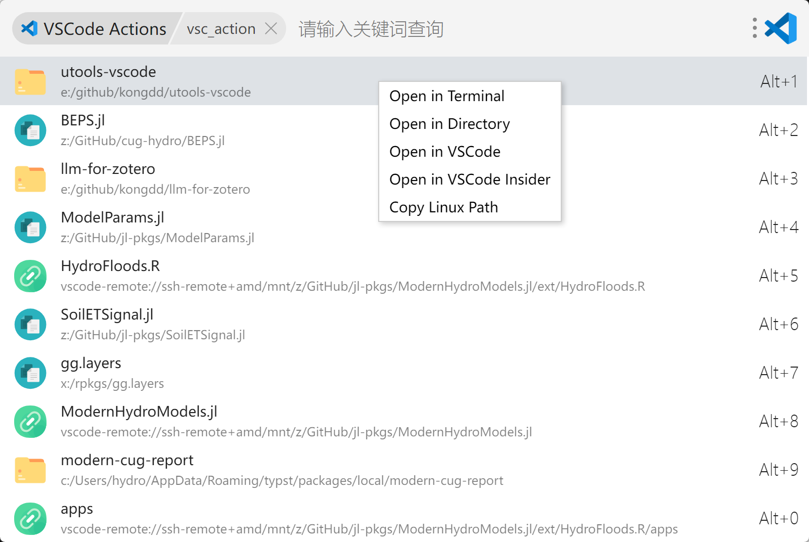

# Code Action

**项目与文件，一搜即开。**

不必记住项目放在哪，也不必在文件夹之间来回翻找。唤起搜索，输入关键词，回车继续工作。

[独立桌面版](app/README.md) · [反馈问题](https://github.com/kongdd/utools-vscode/issues) · [开发与构建](docs/development.md)

## 少找目录，多写代码

- **找回最近项目**：搜索 VSCode 最近打开的项目，本地与远程工作区都能找到。
- **文件不必逐层找**：按名称、类型或目录检索，比如 `*.pdf`、`soil rain`、`path:papers Kong`。
- **按你的习惯打开**：独立版支持 VSCode、Insiders、Zed、目录与终端，不必先打开编辑器再找项目。
- **常用项目放在前面**：收藏置顶，键盘选择，回车打开。
- **数据留在本机**：设置与收藏保存在本地，不做云同步。

## 选择你的使用方式

### 独立桌面版

无需 uTools，常驻托盘，随时用快捷键唤起。

默认快捷键：

| 功能 | macOS | Windows / Linux |
| --- | --- | --- |
| 搜索文件 | `⌘⌃E` | `Ctrl+Alt+E` |
| 搜索项目，用 Zed 打开 | `⌘⌃Z` | `Ctrl+Alt+Z` |
| 搜索项目，用 VSCode 打开 | `⌘⌃C` | `Ctrl+Alt+C` |

[了解独立版 →](app/README.md)

> 独立版尚未发布安装包，目前需[本地构建](docs/development.md#独立桌面版)。

### uTools 插件

习惯 uTools？保留原来的工作流：输入 `vsc` 搜索最近项目，输入 `fs_action` 搜索文件，输入 `vsc-setting` 打开设置。

文件搜索依赖本机的 [fs](https://github.com/kongdd/fs) 索引；首次使用前需建立索引。

## 从这里开始

唤起搜索 → 输入关键词 → `↑` / `↓` 选择 → `Enter` 打开。

右键可以选择其他打开方式、复制路径或置顶项目。

---

uTools 插件基于 [mohuishou/utools](https://github.com/mohuishou/utools) 开发，感谢原作者。
